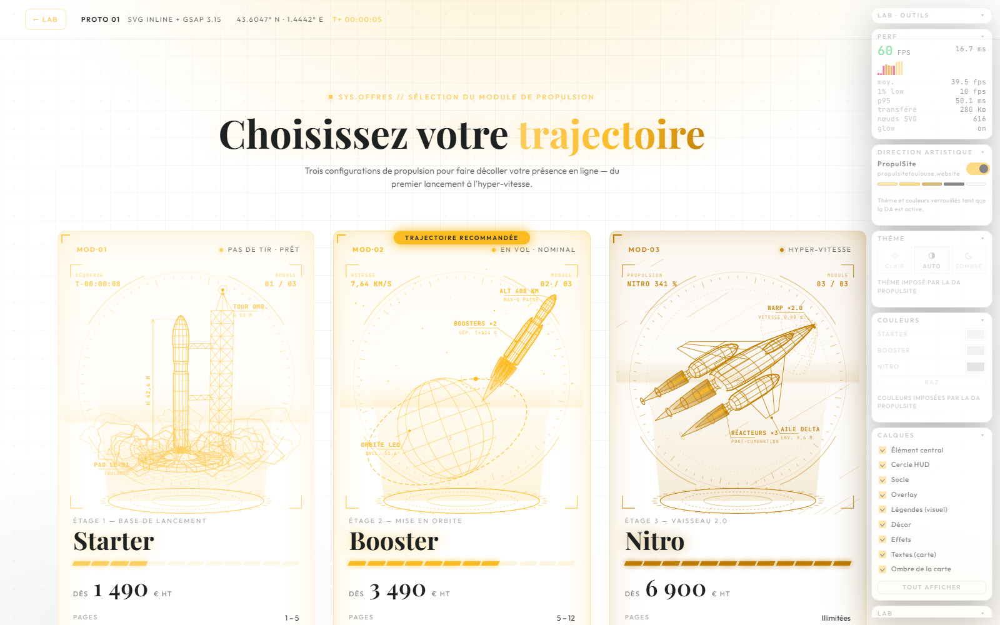

# IllustrationWireframe · Lab comparatif

Monorepo d'expérimentation : **une section d'offres interactive au style « Wireframe 3D / HUD Sci-Fi »** (lignes néon filaires, glow, éléments transparents façon plan d'aérospatiale), réalisée avec **une technologie par sous-dossier** pour comparer rendu, poids, performances et facilité de production.

Thème commun, 3 états d'une fusée :

| Offre | Visuel |
|---|---|
| **Starter** | Base de lancement : lanceur élancé (interétage, coiffe, grappe de 4 moteurs, ailerons) sur son pas de tir, tour ombilicale, et **nuage de décollage** au survol |
| **Booster** | Fusée en vol / mise en orbite |
| **Nitro** | Vaisseau 2.0 en hyper-vitesse, réacteurs dopés |

## Démarrer

```bash
npm install          # outillage du lab (playwright-core)
npm run dev          # dashboard + démos → http://localhost:4600/
npm run verify       # régénère ce qui est généré, puis vérifie que les 4 démos s'affichent sans erreur
npm run measure      # poids, FPS et captures des 4 démos
npm run build:02     # build Vite du prototype Three.js (nécessaire une fois)
npm run svg:build    # régénère les SVG du prototype 01
npm run bundle:04    # réassemble le Web Component
```

Le dashboard [`index.html`](index.html) s'ouvre aussi directement en `file://`. Il liste les 4 démos, affiche les métriques mesurées et propose une vue **côte à côte** (4 iframes miniatures).

## Structure

```
IllustrationWireframe/
├── index.html            dashboard du lab
├── 01-svg-gsap/          ✅ SVG inline + GSAP (3D pré-calculée en Node → SVG 2D)
├── 02-threejs-r3f/       ✅ Three.js / WebGL temps réel (bloom, occludeurs)
├── 03-canvas-glsl/       ✅ Canvas 2D, projection 3D maison, zéro dépendance
├── 04-spline-web/        ✅ Web Component <wire-rocket> (+ emplacement Spline)
├── test-layout/          banc de mises en page : une offre a la fois, 21 layouts
├── _shared/
│   ├── offers.css        habillage commun des cartes (design identique partout)
│   ├── dock.js           colonne de panneaux repliables (touche D)
│   ├── perf-hud.js       compteur FPS commun (touche P) + API lue par le banc
│   ├── theme.js          thème clair / auto / sombre
│   ├── layers.js         les 7 calques du visuel
│   ├── accents.js        couleur principale de chaque offre
│   ├── art-direction.css l'habillage de la DA PropulSite (couleurs + typo de la marque)
│   ├── art-direction.js  l'interrupteur, le verrouillage des réglages qu'elle impose
│   ├── visual-tune.js    opacité et saturation des visuels (eux seuls)
│   └── results.js        résultats générés par npm run measure (lus par le dashboard)
└── tools/
    ├── serve.mjs         serveur statique sans dépendance
    ├── verify.mjs        contrôle que les 4 démos se chargent, s'animent et n'erreurent pas
    └── measure.mjs       banc de mesure (Playwright + Chrome/Edge installés)
```

Les 4 démos partagent **le même habillage de cartes, le même contenu et les mêmes formes** : seule la technologie de rendu de l'illustration change.

Chaque démo a son `README.md` : rendu obtenu, poids / FPS, facilité d'animation et de personnalisation.

En complément, le [banc de layouts](test-layout/) ne compare plus des technologies mais des
**mises en page** : une seule offre à l'écran et vingt-et-une façons de la présenter, en quatre familles —
six où le visuel est **à côté** du texte, cinq où il passe **en fond de section** et où l'offre
flotte au-dessus, cinq où les offres deviennent des **cartes** et où le visuel sort des cartes pour habiller la
section, et cinq qui ne sont plus des mises en page mais des **mécaniques de site** : tableau
comparatif, onglets, visuel collant piloté par le défilement, barre d'achat collante,
configurateur. Chaque section y démarre éteinte et ne charge son visuel qu'à la demande.

## Le dock du lab

Une colonne de panneaux repliables à droite de chaque démo (touche **D** pour tout replier,
**P** pour le compteur). Réglages mémorisés d'une visite à l'autre.

Le dock **flotte au-dessus de la page** : aucune gouttière ne lui est réservée, les sections
gardent toute la largeur de l'écran. Il s'estompe tant qu'on ne le survole pas, et les mises en
page décalent leur contenu vers la gauche uniquement quand l'écran est trop étroit pour passer
à côté — jamais de plus que sa propre largeur, de sorte qu'aucun bouton ne finit sous lui
(vérifié de 1280 à 1920 px).

**Sous 1024 px, il change de forme** : une colonne de 194 px sur un téléphone de 360, c'était la
moitié de la page recouverte. Il devient alors un **tiroir au ras du bas**, replié par défaut,
qui s'ouvre par-dessus le contenu sans lui prendre de largeur. Les deux formats gardent leur
propre mémoire d'ouverture : déplié sur grand écran, replié sur petit.

| Panneau | Ce qu'il fait |
|---|---|
| **Perf** | FPS instantané, moyenne, 1 % low, p95, poids transféré |
| **Direction artistique** | Bascule tout le lab dans la DA de PropulSite (voir plus bas) |
| **Thème** | Clair · Auto (suit le système) · Sombre |
| **Couleurs** | Une couleur principale par offre, modifiable en direct |
| **Visuels** | Opacité et saturation du dessin — et de lui seul |
| **Calques** | Allume / éteint les 9 éléments de la carte |
| **Lab** | Glow (ou bloom), animations, rejouer l'intro |

Le panneau **Visuels** pose deux jetons (`--illu-opacity`, `--illu-saturate`) sur les seules
zones de dessin : la vignette des cartes, les plans du banc de layouts et le canvas plein cadre
du prototype Three.js. Le texte, les prix, les boutons et le dock n'en voient rien — c'est tout
l'intérêt : on règle le rendu du visuel sans toucher à la lisibilité de l'offre.

Les deux réglages sont **séparés dans la feuille** : tant qu'ils valent 100 %, aucune règle ne
s'applique. L'opacité est quasi gratuite ; la saturation, elle, fait repasser la carte dans une
passe de filtre à chaque image (quelques fps sur le prototype SVG). Elle n'apparaît donc que si
on y touche vraiment.

### Les 9 calques

`model` · `ring` · `base` · `overlay` · `labels` · `decor` · `fx` · `cardtext` · `shadow` — même
vocabulaire dans les 4 démos, donc comparables une à une.

| Calque | Contenu |
|---|---|
| Élément central | fusée, lanceur et ses boosters, vaisseau |
| Cercle HUD | cadran radar et graduations |
| Socle | socle holographique et cône de lumière |
| Overlay | ligne de balayage, réticule, coins d'écran |
| Légendes (visuel) | étiquettes techniques, cotes, télémétrie de l'illustration |
| Décor | grille au sol, planète, orbite, étoiles, traînées warp |
| Effets | flammes, anneaux de réacteur, vapeurs, onde de choc |
| Textes (carte) | en-tête, badge, étage, nom, prix, specs et bouton — masqués **sans perdre leur place**, la carte garde sa forme |
| Ombre de la carte | halo interne du cadre, et son renfort au survol |

Les deux derniers ne touchent pas à l'illustration mais à la carte elle-même : une règle CSS de
`_shared/offers.css` suffit, et elle vaut immédiatement pour les 4 démos puisqu'elles partagent
le même habillage. Décocher les deux laisse le cadre nu avec son seul visuel.

Éteindre un calque n'emporte pas ce qui s'y accroche : masquer la fusée laisse ses flammes
visibles. Chaque techno s'y prend différemment — c'est un point de comparaison de plus :

- **01 SVG** : zéro ligne de JavaScript. Les groupes portent `data-layer`, une règle CSS les masque.
- **02 Three.js** : les objets 3D portent `userData.layer`, on bascule leur `visible` ; le HUD, lui,
  reste du DOM et suit la même règle CSS.
- **03 Canvas 2D** : le moteur saute les traits du nœud éteint mais continue vers ses enfants.
- **04 Web Component** : la CSS de la page n'entre pas dans le Shadow DOM — le composant écoute
  l'événement `layerchange` et masque lui-même ses éléments.

### Couleurs

Chaque carte est pilotée par **un seul jeton** (`--c-starter`, `--c-booster`, `--c-nitro`). Tout en
découle : bordures, fonds, jauges et CTA via `color-mix()`, traits de l'illustration via
`currentColor`, et les démos Canvas / WebGL relisent le jeton quand il change. Le panneau Couleurs
ne fait donc que réécrire ces trois variables. Seuls le blanc incandescent des flammes (`--hot`) et
l'ambre de la balise restent indépendants : ce sont des couleurs de matière, pas d'identité.

## Thème clair / sombre

Ce n'est pas une inversion : ce sont **deux identités graphiques**.

| | Sombre | Clair |
|---|---|---|
| Intention | hologramme néon dans le noir | plan technique à l'encre sur papier |
| Halo | filtres SVG / bloom WebGL / additif Canvas | supprimé — le trait porte seul |
| Accents | cyan / violet / magenta fluo | teal, indigo et magenta encrés |

Là encore, chaque technologie s'adapte à sa manière :

- **01 SVG** : rien à coder, tout est en `currentColor` et en jetons CSS ; seuls les filtres de
  glow sont coupés en clair.
- **02 Three.js** : le plus de travail. Le canvas passe de `mix-blend-mode: screen` à `multiply`,
  la couleur de fond et celle des occludeurs changent, le bloom est désactivé, et chaque matériau
  est reteinté selon son rôle (`accent`, `hot`, `plume`, `bg`).
- **03 Canvas 2D** : le mélange additif devient un tracé normal, traits épaissis de 25 %.
- **04 Web Component** : il hérite de la couleur de sa carte et écoute `themechange` — déposé dans
  une page tierce, il suit le thème de son hôte.

## La direction artistique PropulSite

Un interrupteur dans le dock rhabille **tout le lab** — les quatre démos, le banc de layouts et
ce tableau de bord — avec l'identité de [propulsitetoulouse.website](https://www.propulsitetoulouse.website).



C'est une **couche mince**, et c'est volontaire : la DA ne fait que réécrire des jetons CSS.
Tout le lab est déjà piloté par eux — cartes, CTA, jauges, et jusqu'aux traits du SVG qui sont
en `currentColor`. Le rendu tient donc dans une feuille, `_shared/art-direction.css` ; le module
JS ne pose que l'attribut, verrouille deux panneaux et prévient les démos une fois.

| | Relevé sur le site |
|---|---|
| Couleurs | `#fbbb21` (jaune marque) · `#fccd5f` `#fde09b` `#fef2d7` `#fef9eb` (rampe) · `#1e2122` (encre) · `#f8f8f8` `#f3f4f6` (fonds) · blanc |
| Typographie | **Playfair Display** 700 pour les titres · **Outfit** 300-600 pour le reste |
| Formes | boutons jaunes pleins, rayon 8 px · cartes blanches, rayon 12 px |
| Fond | papier blanc et constellation grise |

Les trois offres suivent la **rampe jaune** (`#fccd5f` · `#fbbb21` · `#c07d00`) : la marque n'a
qu'un accent, et la gamme se lit par l'intensité. Elles restent dans les tons moyens exprès —
une offre à l'encre noircissait les aplats translucides du visuel (cône d'hologramme, fumée) que
le thème clair gère très bien en teintes moyennes.

La DA pose aussi `data-theme="light"` : tout ce que le thème clair sait déjà faire — couper le
halo néon, épaissir le trait, remonter les lignes cachées — s'applique sans être réécrit. Et
puisque le site est clair, elle **verrouille** les deux réglages qui la contrediraient, Thème et
Couleurs, grisés avec un mot d'explication. Les calques, le compteur et le panneau Lab restent
libres : ils ne touchent pas à l'identité.

### Ce que le premier jet a coûté

La version initiale injectait sa feuille en JavaScript et provoquait trois défauts visibles.
Le relevé au chargement les a tous datés :

| Symptôme | Cause | Correction |
|---|---|---|
| La page vire de couleur ~250 ms après l'affichage | La feuille était **injectée par le JS**, donc le premier rendu utilisait encore la palette du lab | Une vraie feuille chargée dans le `<head>` avec les autres |
| Les titres changent de police ~550 ms | Les polices n'étaient demandées **qu'au montage**, après `DOMContentLoaded` | Le script de tête les demande dès qu'il voit la DA active |
| Les visuels sautent | **Quatre `themechange` en 7 ms** (accent, thème, accent, art) : Canvas et WebGL se reteintaient quatre fois | Un seul événement, et `LabAccents.suspend()` se tait quand il n'a rien à retirer |

S'y ajoutait un piège de spécificité, invisible à l'œil et net au calcul : `:root[data-theme="light"]`
pèse **(0,2,0)** — `:root` est une pseudo-classe — alors que `html[data-art="propulsite"]` ne pèse
que (0,1,1). La typo passait, les couleurs non. D'où le `html:root[data-art="propulsite"]` de la
feuille, qui pèse (0,2,1).

Dernier écueil : `theme.js` réappliquait le thème mémorisé après le script de tête et rallumait
le néon sur fond papier. Il ne réécrit plus un attribut déjà posé — l'éteindre rend à
l'utilisateur son thème et ses couleurs exactement comme il les avait laissés.

## Comparatif mesuré

| | 01 SVG + GSAP | 02 Three.js | 03 Canvas 2D | 04 Web Component |
|---|---|---|---|---|
| Poids prod (gzip) | 75 Ko (dont GSAP 37) | **~145 Ko** | **19 Ko** | 21 Ko (composant seul : 11) |
| FPS repos | 59,9 | 59,9 | 59,9 | 59,9 |
| FPS survol des 3 cartes | 58,7 | 59,9 | 59,4 | 59,9 |
| FPS CPU ×4 (≈ mobile) | 37,2 (1 % low 20) | **54,9** (low 30) | 23,1 (low 12) | 31,5 (low 20) |
| Vraie 3D temps réel | ✗ (angle figé au build) | ✓ | ✓ | ✓ |
| Lignes cachées | pointillés (calculés) | masquées (profondeur) | pointillés (calculés) | pointillés (calculés) |
| Visible sans JS / indexable | **✓** | ✗ | ✗ | ✗ |
| Calques | CSS seule | `visible` des objets 3D | filtre dans le moteur | événement + Shadow DOM |
| Distribution | markup dans la page | bundle + build | 3 fichiers JS | **1 fichier, 1 tag** |

> Les poids mesurés par le banc incluent l'outillage du lab (dock, thème, calques, couleurs,
> compteur, direction artistique, réglage des visuels : 15,5 Ko gzip) ; la colonne « poids prod » l'exclut, puisqu'il ne part pas en production.

### Ce que les mesures disent

1. **Sur un ordinateur de bureau, les quatre tiennent 60 fps**, même avec les 3 cartes survolées
   en même temps. Le choix ne se joue donc pas là.
2. **Tout se décide sous contrainte CPU.** Ralenti ×4 (proxy d'un mobile milieu de gamme) :
   Three.js reste à 54,9 fps parce que le GPU fait le travail ; le SVG tient 37,2 ; le Canvas 2D
   et le Web Component tombent à 23-32, puisque la projection de ~7 000 segments y est refaite
   par le processeur à chaque image.
3. **Le halo ne coûte pas grand-chose.** Mesuré en A/B alterné sur le prototype 01, CPU ralenti ×4 :
   29,3 fps avec les filtres contre 31,8 sans, soit ~8 % — avec surtout des à-coups plus fréquents
   (1 % low de 10 contre 20). C'est une piste d'optimisation, pas un défaut rédhibitoire.
4. **Le plus léger n'est pas le plus fluide** : 19 Ko pour le Canvas 2D, mais c'est lui qui souffre
   le plus sur mobile simulé.
5. **Un seul candidat survit sans JavaScript** : le SVG du prototype 01, qui reste visible et
   indexable — un argument de poids pour une section d'offres commerciale.

> Prudence sur les valeurs CPU ×4 : elles varient de ±15 % selon la charge de la machine au moment
> du relevé. Les comparaisons d'un même tableau ont été faites dans la même campagne ; les écarts
> inférieurs à ~10 % ne veulent rien dire.

### Recommandation pour une section d'offres PropulSite

- **Site vitrine classique, priorité SEO et légèreté** → prototype **01 (SVG + GSAP)**, en allégeant le glow (filtre au survol uniquement, ou halo par doublage de tracé comme en 03).
- **Effet « waouh » assumé, page de vente ou landing premium** → prototype **02 (Three.js)**, avec une image de repli pour le SSR et les machines sans GPU.
- **Réutilisation sur plusieurs sites clients / WordPress** → prototype **04 (`<wire-rocket>`)** : un fichier de 11 Ko, aucun build, aucun conflit CSS.
- **Spline** reste pertinent si tu veux *éditer visuellement* les scènes : c'est le seul chemin sans code, mais il demande ton compte et pèse 1 à 3 Mo.

### Protocole de mesure

`tools/measure.mjs` ouvre chaque démo dans un Chrome headless neuf (cache vide), piloté par Playwright : viewport 1440×1000, DPR 1, intro laissée se jouer 4 s, puis FPS relevés sur 5 s via `_shared/perf-hud.js` dans 4 cas : **repos**, **boost** (survol forcé des 3 cartes), **CPU ralenti ×4** (throttling CDP, proxy d'un mobile milieu de gamme), **sans glow**. Le poids vient de la Resource Timing API (non compressé en dev, hors webfonts cross-origin). Le GPU utilisé est reporté dans les résultats (actuellement iGPU AMD Radeon 660M via ANGLE D3D11).

> Ces valeurs servent à **comparer les démos entre elles** dans les mêmes conditions, pas à fixer une vérité absolue. Pour du réel mobile, ouvrir la démo sur un téléphone avec la touche P / le HUD de perf.

## Pistes non testées (hors périmètre, à garder en tête)

- **Rive** (state machine vectorielle, runtime ~100-150 Ko) : très fort pour les interactions complexes, mais les animations se font dans l'éditeur Rive. Pertinent si un motion designer produit les états.
- **Lottie** : export JSON After Effects, bien pour une boucle passive, faible pour l'interactivité fine.
- **TresJS** : l'équivalent Vue / Nuxt de React Three Fiber, à envisager pour porter le prototype 02 dans la stack PropulSite.

## Notes

- **Spline n'a pas pu être testé en conditions réelles** : le format `.splinecode` est propriétaire et sans API d'écriture publique, une scène ne peut être créée que dans l'éditeur Spline (compte requis). Le prototype 04 contient l'emplacement d'intégration prêt à recevoir une URL d'export — voir son README.
- Les contenus et prix des offres sont **fictifs** (placeholders de démo).
- Le banc utilise **Playwright et non Puppeteer** : sur ce poste, l'extension Cold Turkey ferme les instances Chrome qui ne l'ont pas installée, et puppeteer perdait ses pages au bout de quelques secondes.
